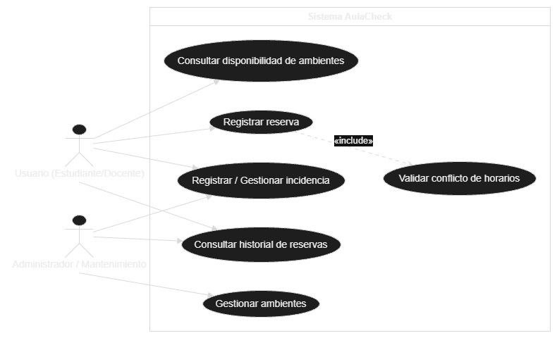
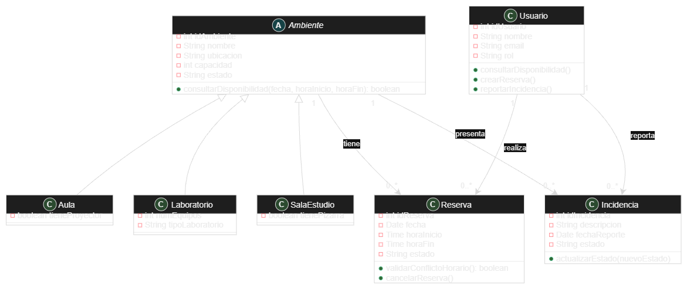

# AulaCheck

Sistema de gestión de ambientes universitarios desarrollado en **Java 17** para el curso de
**Desarrollo de Software Orientado a Objetos**.

AulaCheck permite consultar la disponibilidad de aulas, laboratorios y salas de estudio, registrar
reservas evitando conflictos de horarios, controlar incidencias sobre el estado de los ambientes y
consultar el historial de reservas para optimizar su utilización.

## Diagramas UML

| Casos de uso | Diagrama de clases |
|---|---|
|  |  |

## Estructura del proyecto

```
AulaCheck/
├── pom.xml
├── docs/diagramas/                 # Diagramas UML
└── src/
    ├── main/java/com/aulacheck/
    │   ├── Main.java               # Demo por consola de los casos de uso
    │   ├── model/                  # Clases del diagrama de clases
    │   │   ├── Ambiente (abstracta) ── Aula, Laboratorio, SalaEstudio
    │   │   ├── Usuario, Reserva, Incidencia
    │   │   └── RolUsuario, EstadoAmbiente, EstadoReserva, EstadoIncidencia
    │   ├── service/                # Lógica de los casos de uso
    │   │   ├── AmbienteService     # Gestionar ambientes / consultar disponibilidad
    │   │   ├── ReservaService      # Registrar reserva / historial
    │   │   └── IncidenciaService   # Registrar / gestionar incidencia
    │   └── exception/              # Excepciones de reglas de negocio
    └── test/java/com/aulacheck/    # Pruebas JUnit 5
```

## Correspondencia UML → Java

| UML | Java |
|---|---|
| `Ambiente` (abstracta) y sus 3 subclases | Herencia: `Ambiente` → `Aula`, `Laboratorio`, `SalaEstudio` |
| Ambiente 1 — 0..* Reserva ("tiene") | `Ambiente.reservas` |
| Ambiente 1 — 0..* Incidencia ("presenta") | `Ambiente.incidencias` |
| Usuario 1 — 0..* Reserva ("realiza") | `Usuario.reservas` |
| Usuario 1 — 0..* Incidencia ("reporta") | `Usuario.incidencias` |
| `«include» Validar conflicto de horarios` | `Reserva.validarConflictoHorario()` invocado desde `Usuario.crearReserva()` |
| Atributos `String estado` | Enumeraciones (`EstadoAmbiente`, `EstadoReserva`, `EstadoIncidencia`) |
| Atributos `Date` / `Time` | `LocalDate` / `LocalTime` (`java.time`) |
| Actores Usuario / Administrador-Mantenimiento | `RolUsuario` con permisos por rol |

## Conceptos de POO aplicados

- **Abstracción y herencia**: `Ambiente` abstracta con `getTipo()` abstracto.
- **Polimorfismo**: cada subclase implementa `getTipo()`; los servicios trabajan con `Ambiente`.
- **Encapsulamiento**: atributos privados, colecciones expuestas como solo lectura y asociaciones enlazadas solo desde el paquete `model`.
- **Asociaciones bidireccionales** entre `Usuario`, `Ambiente`, `Reserva` e `Incidencia`.
- **Manejo de excepciones** propias: `ConflictoHorarioException`, `AmbienteNoDisponibleException`, `PermisoDenegadoException`.
- **Separación de responsabilidades**: modelo / servicios / excepciones.

## Reglas de negocio

- Una reserva no puede cruzarse con otra **activa** del mismo ambiente (reservas contiguas, como 8-10 y 10-12, sí son válidas).
- La hora de inicio debe ser anterior a la hora de fin.
- Solo se reservan ambientes en estado `DISPONIBLE`.
- Al reportar una incidencia el ambiente pasa a `EN_MANTENIMIENTO`; al resolver todas las pendientes vuelve a `DISPONIBLE`.
- Solo el **administrador** gestiona ambientes y ve el historial completo; **administrador** y **mantenimiento** gestionan incidencias.
- Una reserva solo la cancela su dueño o un administrador.

## Requisitos

- JDK 17 o superior
- Maven 3.8+ (opcional)

## Ejecución

Con Maven:

```bash
mvn test                     # ejecuta las pruebas
mvn package                  # genera target/aulacheck-1.0.0.jar
java -jar target/aulacheck-1.0.0.jar
```

Sin Maven:

```bash
mkdir out
javac -encoding UTF-8 -d out $(find src/main -name "*.java")
java -cp out com.aulacheck.Main
```

## Subir a GitHub

```bash
git init
git add .
git commit -m "Versión inicial de AulaCheck"
git branch -M main
git remote add origin https://github.com/<tu-usuario>/AulaCheck.git
git push -u origin main
```

## Integrantes

- Christopher William Vásquez Vasquez 
- Fabiano Josue Enriquez Molina
- Edgard Darick Arcana Gonzales

Curso: Desarrollo de Software Orientado a Objetos
