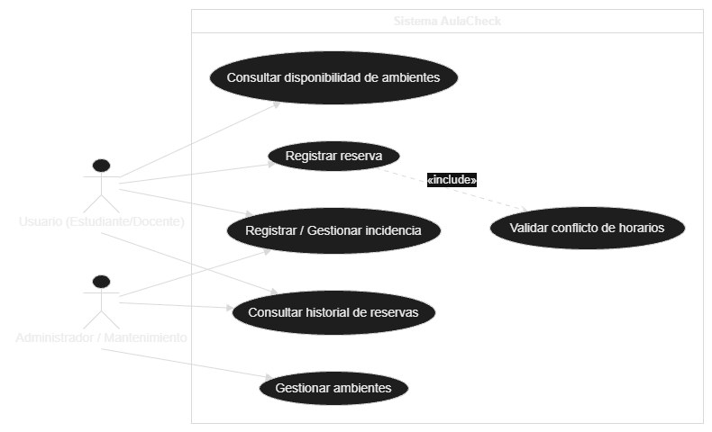
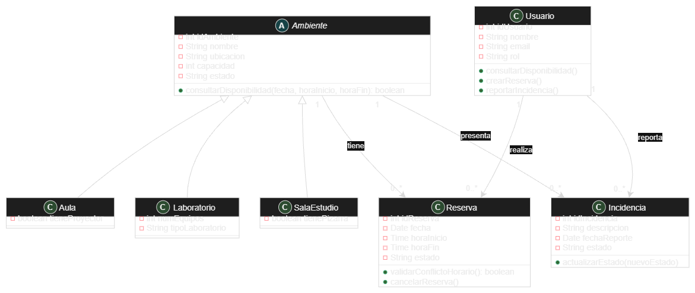

# AulaCheck

Sistema de gestión de ambientes universitarios desarrollado en **Java 17** para el curso de
**Desarrollo de Software Orientado a Objetos**.

AulaCheck permite consultar la disponibilidad de aulas, laboratorios y salas de estudio, registrar
reservas evitando conflictos de horarios, controlar incidencias sobre el estado de los ambientes y
consultar el historial de reservas para optimizar su utilización.

## Diagramas UML

| Casos de uso | Diagrama de clases |
|---|---|
|  |  |

## Estructura del proyecto

```
AulaCheck/
├── pom.xml
├── data/                           # Archivos JSON generados al cerrar la app (no se suben a Git)
├── docs/
│   ├── diagramas/                  # Diagramas UML (PNG y código PlantUML)
│   └── evidencias/sprint3/         # Capturas del Sprint 3
└── src/
    ├── main/
    │   ├── java/com/aulacheck/
    │   │   ├── Main.java           # Punto de entrada de la aplicación Swing
    │   │   ├── PruebaBD.java       # Prueba manual de la conexión y repositorios JDBC
    │   │   ├── ui/                 # Interfaz gráfica en Java Swing
    │   │   │   ├── AulaCheckFrame      # Ventana principal; carga JSON al abrir y guarda al cerrar
    │   │   │   ├── PanelAmbientes      # Consulta de disponibilidad y gestión admin
    │   │   │   ├── PanelReservas       # Registro, historial y cancelación de reservas
    │   │   │   └── PanelIncidencias    # Reporte y atención técnica de fallas
    │   │   ├── model/              # Clases del diagrama de clases
    │   │   │   ├── Ambiente (abstracta) ── Aula, Laboratorio, SalaEstudio
    │   │   │   ├── Usuario, Reserva, Incidencia
    │   │   │   └── RolUsuario, EstadoAmbiente, EstadoReserva, EstadoIncidencia
    │   │   ├── service/            # Lógica de los casos de uso
    │   │   │   ├── AmbienteService     # Gestionar ambientes / consultar disponibilidad
    │   │   │   ├── ReservaService      # Registrar reserva / historial
    │   │   │   └── IncidenciaService   # Registrar / gestionar incidencia
    │   │   ├── persistence/
    │   │   │   ├── json/           # Persistencia en archivos JSON (Gson)
    │   │   │   │   ├── JsonStore, AmbienteAdapter
    │   │   │   │   └── Usuario/Ambiente/Reserva/IncidenciaJsonRepository
    │   │   │   └── jdbc/           # Persistencia alternativa en PostgreSQL (JDBC)
    │   │   │       ├── ConexionBD
    │   │   │       └── Usuario/Ambiente/Reserva/IncidenciaJdbcRepository
    │   │   └── exception/          # Excepciones de reglas de negocio
    │   └── resources/
    │       ├── schema.sql                  # Tablas de PostgreSQL
    │       └── config.properties.example   # Plantilla de conexión a la base de datos
    └── test/java/com/aulacheck/    # Pruebas JUnit 5
```

## Correspondencia UML → Java

| UML | Java |
|---|---|
| `Ambiente` (abstracta) y sus 3 subclases | Herencia: `Ambiente` → `Aula`, `Laboratorio`, `SalaEstudio` |
| Ambiente 1 — 0..* Reserva ("tiene") | `Ambiente.reservas` |
| Ambiente 1 — 0..* Incidencia ("presenta") | `Ambiente.incidencias` |
| Usuario 1 — 0..* Reserva ("realiza") | `Usuario.reservas` |
| Usuario 1 — 0..* Incidencia ("reporta") | `Usuario.incidencias` |
| `«include» Validar conflicto de horarios` | `Reserva.validarConflictoHorario()` invocado desde `Usuario.crearReserva()` |
| Atributos `String estado` | Enumeraciones (`EstadoAmbiente`, `EstadoReserva`, `EstadoIncidencia`) |
| Atributos `Date` / `Time` | `LocalDate` / `LocalTime` (`java.time`) |
| Actores Usuario / Administrador-Mantenimiento | `RolUsuario` con permisos por rol |

## Conceptos de POO aplicados

- **Abstracción y herencia**: `Ambiente` abstracta con `getTipo()` abstracto.
- **Polimorfismo**: cada subclase implementa `getTipo()`; los servicios trabajan con `Ambiente`.
- **Encapsulamiento**: atributos privados, colecciones expuestas como solo lectura y asociaciones enlazadas solo desde el paquete `model`.
- **Asociaciones bidireccionales** entre `Usuario`, `Ambiente`, `Reserva` e `Incidencia`.
- **Manejo de excepciones** propias: `ConflictoHorarioException`, `AmbienteNoDisponibleException`, `PermisoDenegadoException`.
- **Separación de responsabilidades**: modelo / servicios / excepciones.

## Reglas de negocio

- Una reserva no puede cruzarse con otra **activa** del mismo ambiente (reservas contiguas, como 8-10 y 10-12, sí son válidas).
- La hora de inicio debe ser anterior a la hora de fin.
- No se pueden registrar reservas en fechas u horas pasadas.
- Solo se reservan ambientes en estado `DISPONIBLE`.
- Al reportar una incidencia el ambiente pasa a `EN_MANTENIMIENTO`; al resolver todas las pendientes vuelve a `DISPONIBLE`.
- Solo el **administrador** gestiona ambientes y ve el historial completo; **administrador** y **mantenimiento** gestionan incidencias.
- Una reserva solo la cancela su dueño o un administrador.

## Persistencia de datos

AulaCheck conserva la información entre sesiones de dos formas:

### 1. Archivos JSON (usada por la aplicación)

Los usuarios, ambientes, reservas e incidencias se guardan en la carpeta `data/` (Gson):
`usuarios.json`, `ambientes.json`, `reservas.json` e `incidencias.json`.

- **Al abrir**: `AulaCheckFrame` carga los archivos. Si no existen (primera ejecución), se crean con los datos de demostración.
- **Al cerrar** la ventana: se guarda el estado completo.
- Las relaciones (reserva → usuario y ambiente, incidencia → usuario y ambiente) se guardan por **id**, y se reconstruyen al cargar.
- `AmbienteAdapter` conserva el tipo concreto de cada ambiente (`Aula`, `Laboratorio`, `SalaEstudio`).
- Si un archivo está dañado, se muestra un aviso y, al cerrar, se conservan copias `*.json.bak` de los originales.
- `data/` está en `.gitignore`: son datos locales de cada equipo.

### 2. PostgreSQL (almacenamiento alternativo, vía JDBC)

Los repositorios del paquete `persistence.jdbc` guardan y cargan las mismas entidades en PostgreSQL.

1. Crear la base de datos: `CREATE DATABASE aulacheck;`
2. Ejecutar `src/main/resources/schema.sql` sobre esa base.
3. Copiar `src/main/resources/config.properties.example` a `src/main/resources/config.properties` y completar `db.url`, `db.user` y `db.password`.
4. Ejecutar `com.aulacheck.PruebaBD` para guardar y volver a cargar datos de prueba.

> `config.properties` contiene credenciales y está en `.gitignore`: **no lo subas a GitHub**.
> Actualmente la interfaz gráfica usa JSON; PostgreSQL se verifica con `PruebaBD`.

## Requisitos

- JDK 17 o superior
- Maven 3.8+ (o VS Code con *Extension Pack for Java*)
- PostgreSQL (solo para probar el almacenamiento JDBC)

## Ejecución

Con Maven:

```bash
mvn test                              # ejecuta las pruebas
mvn package                           # genera target/aulacheck-1.0.0.jar (incluye Gson y el driver de PostgreSQL)
java -jar target/aulacheck-1.0.0.jar
```

Desde VS Code: abrir la carpeta del proyecto y ejecutar `Main` (la extensión descarga las dependencias del `pom.xml`).

## Integrantes

- Christopher William Vásquez Vasquez 
- Fabiano Josue Enriquez Molina
- Edgard Darick Arcana Gonzales

Curso: Desarrollo de Software Orientado a Objetos
